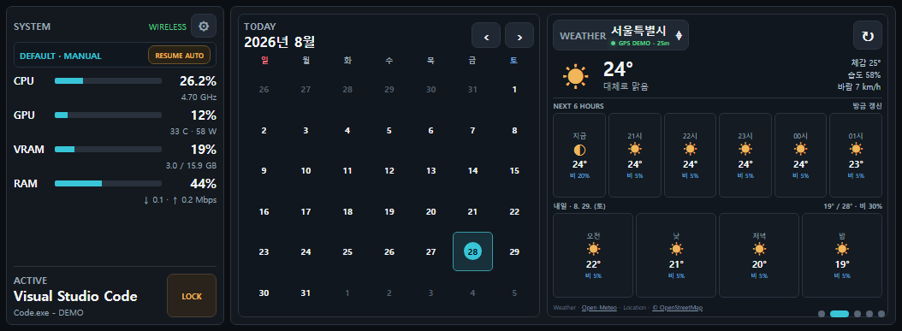

# Android-home-dashboard

안드로이드 폰을 Windows PC용 홈 대시보드로 사용하는 로컬 PWA입니다.

A local PWA that turns an Android phone into a home dashboard for a Windows PC.

`Windows PC → Python bridge → ADB reverse → Android PWA`

---

## 기능 / Features

- PC 상태, 시간, 날씨, 미디어 정보를 한 화면에 표시 / Shows PC status, time, weather, and media information on one screen
- 클립보드 기록 확인 및 다시 복사 / Browse clipboard history and copy previous entries again
- PC 잠금, 절전, 종료 등 빠른 작업 / Run quick actions such as lock, sleep, and shutdown
- 버튼과 매크로를 직접 구성하는 자동화 데크 / Customizable automation deck with buttons and macros
- ADB USB 및 무선 연결 지원 / Supports USB and wireless ADB connections
- 외부 계정이나 클라우드 없이 로컬에서 동작 / Runs locally without an external account or cloud service

---

## 스크린샷 / Screenshots



<p align="center">
  
  
</p>

---

## 요구사항 / Requirements

- Windows 10 또는 Windows 11 / Windows 10 or Windows 11
- Python 3.10 이상 / Python 3.10 or later
- Android 기기와 Chrome / Android device with Chrome
- Android Platform Tools (`adb`) / Android Platform Tools (`adb`)
- 개발자 옵션과 USB 디버깅 활성화 / Developer options and USB debugging enabled

---

## 빠른 시작 / Quick Start

1. 저장소를 클론합니다. / Clone the repository.

```powershell
git clone https://github.com/git-ducu/android-home-dashboard.git
cd android-home-dashboard
```

2. 설치 스크립트를 실행합니다. / Run the installer.

```powershell
.\install.bat
```

3. Android 기기를 USB로 연결하고 디버깅을 허용합니다. / Connect the Android device by USB and allow debugging.

4. 대시보드를 시작합니다. / Start the dashboard.

```powershell
.\start_dashboard.bat
```

5. 휴대폰 Chrome에서 아래 주소를 엽니다. / Open the following address in Chrome on the phone.

```text
http://127.0.0.1:8765
```

홈 화면에 추가하면 전체 화면 앱처럼 사용할 수 있습니다.

Add it to the home screen to use it like a full-screen app.

---

## 무선 ADB / Wireless ADB

USB로 처음 연결한 뒤 무선 모드를 활성화합니다.

Connect by USB once, then enable wireless mode.

```powershell
adb tcpip 5555
adb connect PHONE_IP:5555
```

연결 후 `start_dashboard.bat`을 다시 실행합니다.

Run `start_dashboard.bat` again after the connection is established.

---

## 명령 / Commands

```powershell
.\start_dashboard.bat   # 시작 / Start
.\stop_dashboard.bat    # 중지 / Stop
.\status_dashboard.bat  # 상태 확인 / Check status
.\uninstall.bat         # 제거 / Uninstall
```

---

## 자동화 / Automation

대시보드의 Automation 화면에서 버튼을 추가하고 아래 작업을 지정할 수 있습니다.

Add buttons on the Automation screen and assign actions such as:

- 앱 또는 파일 실행 / Launch an app or file
- 웹사이트 열기 / Open a website
- 키 입력 전송 / Send keystrokes
- 미디어 제어 / Control media playback
- 여러 작업을 순서대로 실행 / Run multiple actions in sequence

자동화 설정은 로컬 파일에 저장되며 Git에 포함되지 않습니다.

Automation settings are stored locally and are not committed to Git.

---

## 구조 / Architecture

```text
Android Chrome (PWA)
        │
        │ ADB reverse: 127.0.0.1:8765
        ▼
Python local bridge
        │
        ├─ Windows status and actions
        ├─ Media session
        ├─ Clipboard history
        └─ Local automation
```

---

## 개인정보 및 보안 / Privacy and Security

- 서버는 기본적으로 로컬 주소에서만 수신합니다. / The server listens on a local address by default.
- 개인 설정, 로그, 클립보드 데이터는 저장소에서 제외됩니다. / Personal settings, logs, and clipboard data are excluded from the repository.
- 외부 네트워크에 직접 공개하지 마세요. / Do not expose the bridge directly to an external network.
- 종료 및 시스템 작업은 확인 절차를 거칩니다. / Shutdown and system actions require confirmation.

---

## 테스트 / Tests

```powershell
python -m unittest discover -s tests -v
```

실제 기기 테스트에는 Android 기기와 동작 중인 ADB 연결이 필요합니다.

Real-device tests require an Android device with an active ADB connection.

---

## 라이선스 / License

이 프로젝트는 MIT 라이선스로 배포됩니다.

This project is released under the MIT License.

자세한 내용은 [LICENSE](LICENSE)를 확인하세요.

See [LICENSE](LICENSE) for details.
