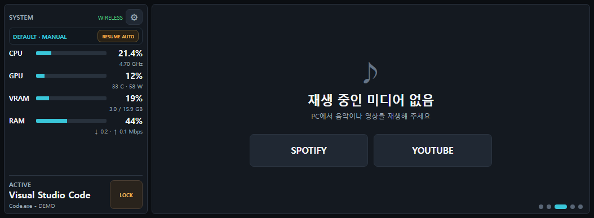
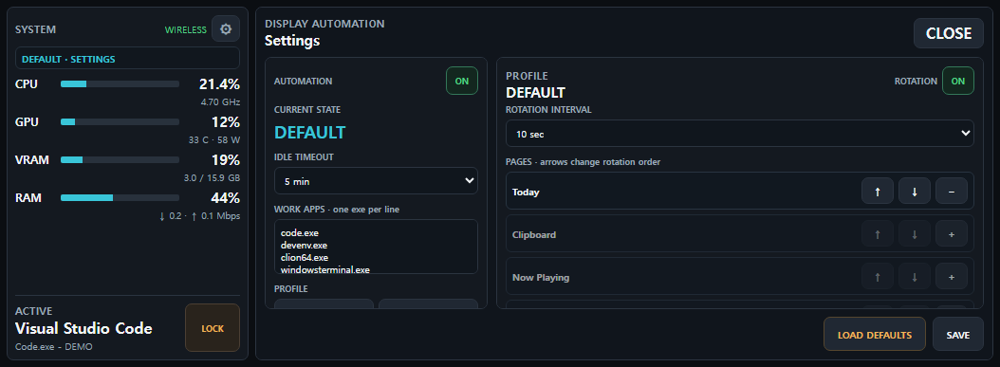

# android-home-dashboard

Windows PC 상태와 미디어, 클립보드, 날씨를 남는 Android 휴대폰에 표시하는 로컬 PWA 대시보드입니다. PC의 Python 브리지는 `127.0.0.1:8765`에만 바인딩되고, Android는 ADB reverse를 통해 같은 주소에 접속합니다.


<p align="center">
  
  
</p>

## 주요 기능

- CPU, GPU, VRAM, RAM, 네트워크와 현재 활성 앱 표시
- Windows 클립보드 기록을 Android의 IndexedDB에 최대 10개 보관하고 다시 복원
- Windows 미디어 세션의 앨범 아트, 재생 상태와 이전/재생/다음 제어
- PresentMon 기반 FPS, 프레임 타임, 최소/최대 및 1% low 표시
- Android GPS 기반 현재 날씨, 6시간 예보와 다음 날 예보
- `GAME > VIDEO > IDLE > WORK > DEFAULT` 우선순위의 화면 자동 전환
- Windows 잠금 시 데이터 수집과 변경 요청을 중단하고, 해제 시 자동 복귀
- USB 또는 무선 ADB 연결과 PWA 자동 실행

## 요구 사항

- Windows 10 또는 11
- Android 휴대폰과 Google Chrome
- 최초 연결용 USB 케이블과 활성화된 USB 디버깅
- 설치 중 Python, Android Platform Tools, PresentMon을 받을 인터넷 연결
- GPU 온도·전력·VRAM 표시는 NVIDIA GPU 권장

## 설치

1. 저장소를 영구적으로 사용할 폴더에 clone하거나 압축을 완전히 풉니다.
2. Android 개발자 옵션에서 USB 디버깅을 켜고 PC 연결을 허용합니다.
3. `install.bat`을 실행하고 관리자 권한 요청을 승인합니다.
4. `start_dashboard.bat`을 실행합니다.
5. 휴대폰 Chrome에 대시보드가 열리면 메뉴에서 앱 설치 또는 홈 화면 추가를 선택합니다.

설치기는 프로젝트 안의 `runtime/`에 전용 Python, ADB, PresentMon과 Python 패키지를 준비하고 Windows 로그인/종료 예약 작업을 등록합니다. 시스템 Python을 별도로 설치할 필요는 없습니다.

### 무선 ADB

휴대폰과 PC를 같은 개인 Wi-Fi에 연결한 뒤 `wireless_setup.bat`을 실행합니다. Android 11 이상에서는 화면 안내에 따라 무선 디버깅 페어링 주소, 코드와 연결 주소를 입력합니다. 연결이 끊기면 USB를 자동 대체 경로로 사용합니다.

## 제어 명령

```bat
dashboard.bat start
dashboard.bat stop
dashboard.bat restart
dashboard.bat status
dashboard.bat install
dashboard.bat uninstall
```

간단한 시작/종료에는 `start_dashboard.bat`과 `stop_dashboard.bat`을 사용할 수 있습니다.

## 화면 자동화

왼쪽 위 설정 버튼에서 자동화 활성화, 유휴 시간, 작업 앱, 상태별 페이지와 회전 순서를 바꿀 수 있습니다. 페이지를 직접 누르거나 스와이프하면 다음 상태 변경 전까지 MANUAL 모드가 유지됩니다. `RESUME AUTO`를 누르면 즉시 자동 모드로 돌아갑니다.

## 로컬 데이터와 보안

- 브리지는 loopback 주소에만 바인딩되며 Android 접근은 ADB reverse를 사용합니다.
- 모든 변경 API는 같은 출처와 실행 시 발급되는 요청 토큰을 확인합니다.
- Windows가 잠겨 있으면 종료를 포함한 변경 API가 거부됩니다.
- `phone_config.json`, ADB 키, 로그, PID, 로컬 자동화 설정과 다운로드된 runtime은 Git에서 제외됩니다.
- 클립보드 기록은 Android Chrome/PWA의 IndexedDB와 실행 중인 PC 메모리에만 저장됩니다.
- 날씨는 휴대폰에서 Open-Meteo에 직접 요청하고, GPS 좌표의 지역명 확인에 OpenStreetMap Nominatim을 사용합니다.

개인키가 포함된 기존 작업 폴더 전체를 복사하거나 공개 저장소에 올리지 마세요. 이 저장소의 `.gitignore`가 적용된 파일만 Git으로 배포해야 합니다.

## 검증

```powershell
runtime\python\python.exe -m unittest discover -s tests -p "test_*.py" -v
powershell.exe -NoProfile -ExecutionPolicy Bypass -File .\tests\browser_smoke.ps1
powershell.exe -NoProfile -ExecutionPolicy Bypass -File .\tests\android_weather_e2e.ps1
```

마지막 명령은 USB 디버깅이 허용된 실제 Android 기기와 열린 Dashboard PWA가 필요합니다.

## 제거

`dashboard.bat uninstall`을 관리자 권한으로 실행한 뒤 폴더를 삭제합니다. 휴대폰에 설치한 PWA는 Android 설정 또는 Chrome에서 별도로 제거합니다.

## 라이선스

[MIT License](LICENSE)
